# Standard Issue: T-shirt Research (IS117-007)

Competitive landscape for [Standard Issue](https://standard-issue-is117.vercel.app), a one-product white T-shirt store ([brand repo](https://github.com/mnguyenht/is117-brand-assignment)). Captured 2026-11-03.

**Finding:** Standard Issue is the only postmodern look and the only calm first visit among the four white-tee sellers checked. Every competitor's checkout adds pressure or a default that Standard Issue does not. Its weak spot is price: a $28 demo price against Muji's $14.90 and Quince tees from $19.90.

Sites: Muji, Quince and Everlane (direct competitors) and Sunspel (adjacent premium reference, for the secondary persona Fiona). Each is read through three lenses: brand archetype, Cialdini's persuasion principles, and modernism vs postmodernism.

## At a glance

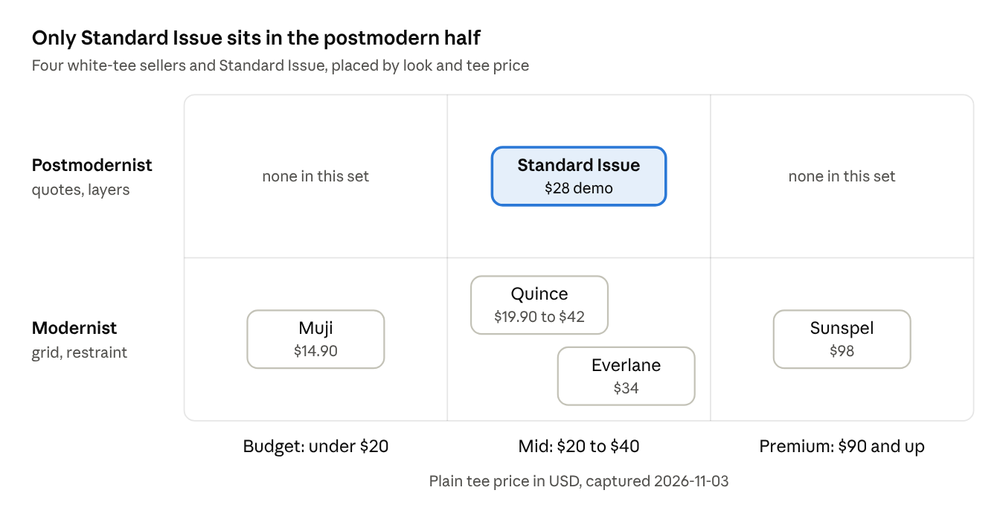

| Site | Role | Tee price (USD) | Archetype | Look | Persuasion seen | First visit |
| --- | --- | --- | --- | --- | --- | --- |
| [Muji](https://www.muji.us/products/jersey-crew-neck-t-shirt-ab1mi25a) | Direct competitor | $14.90 | Everyman, Innocent streak | Modernist, diluted by sale chrome | Social proof, urgency, commitment | Sale bar, Black Friday hero, cookie banner |
| [Quince](https://www.quince.com/men/100-organic-cotton-heavyweight-relaxed-fit-jersey-tee?color=classic-white&size=m) | Direct competitor | $19.90 to $42 | Everyman borrowing Ruler | Modernist with serif luxury cues | Conditional reciprocity, social proof, scarcity, authority | "$40 off" popup ($250 minimum, app only) |
| [Standard Issue](https://standard-issue-is117.vercel.app) | This store | $28 (fictional demo) | Everyman | Postmodernist: kraft paper, crate stamp, label tape | Reciprocity (free styling tip), liking ("nothing more or less") | Unboxing intro |
| [Everlane](https://www.everlane.com/products/mens-essential-organic-crew-uniform-white) | Direct competitor | $34 (3 for $69) | Sage on an Everyman base | Strict modernist | Authority, social proof, commitment, reciprocity | "20% off" email popup |
| [Sunspel](https://us.sunspel.com/products/mens-short-sleeve-crew-neck-t-shirt-white) | Adjacent reference | $98 | Ruler with Creator craft | Heritage modernist, serif | Authority, scarcity, liking | Cookie banner |

Uniqlo and Hanes, both obvious direct competitors, were not captured: their sites returned 403 Access Denied to the automated browser, and the block was not bypassed.

## Muji: the "no-brand" brand, sold like a discount store

Direct competitor. Its name means "no-brand quality goods", the closest idea to Standard Issue's "a white T-shirt is a white T-shirt". The US site buries that calm under sale banners.

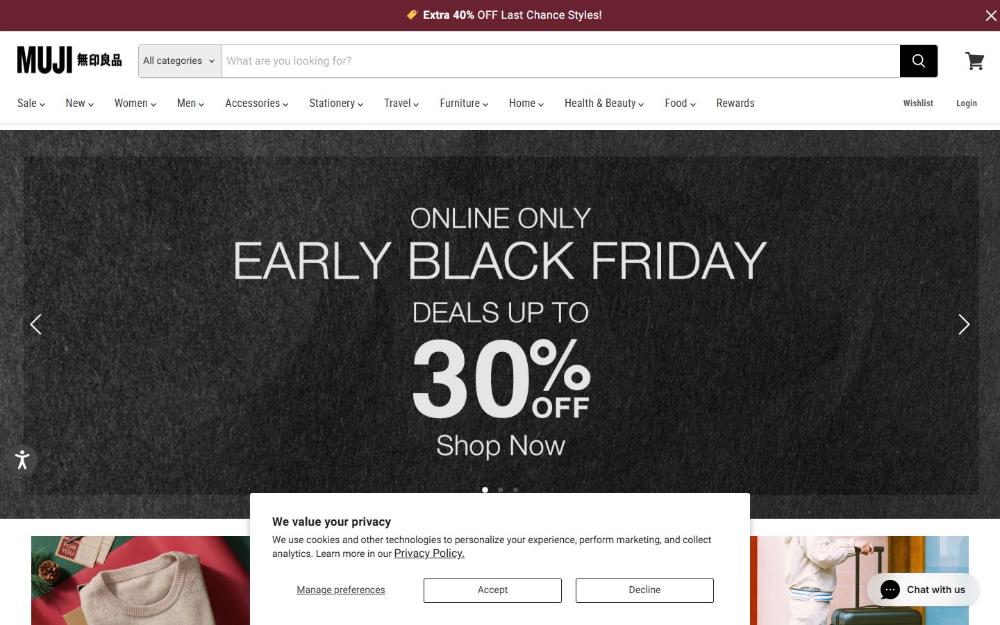

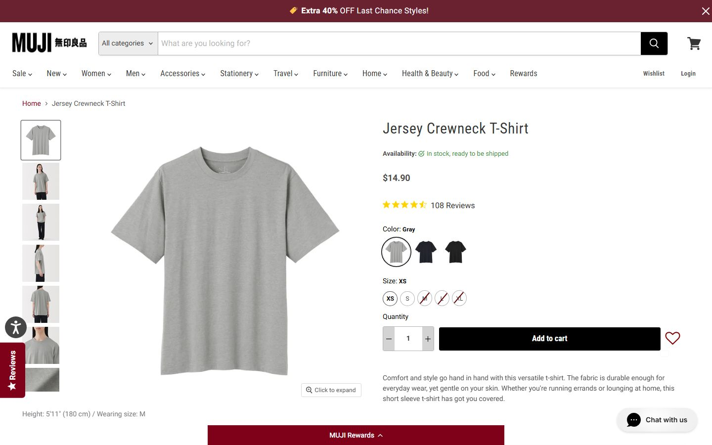

| Phone: homepage | Phone: product page |
| --- | --- |
| 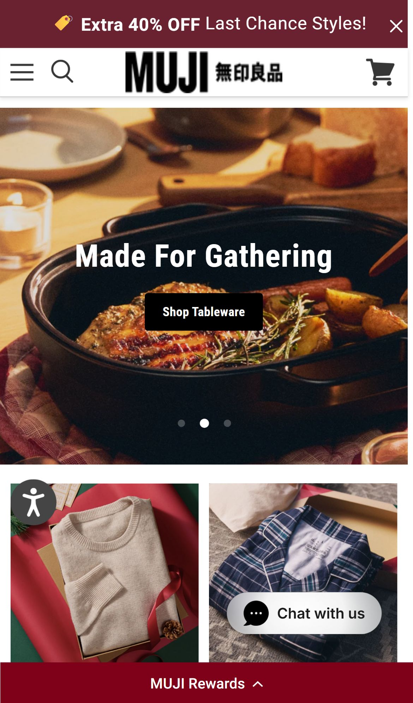 | 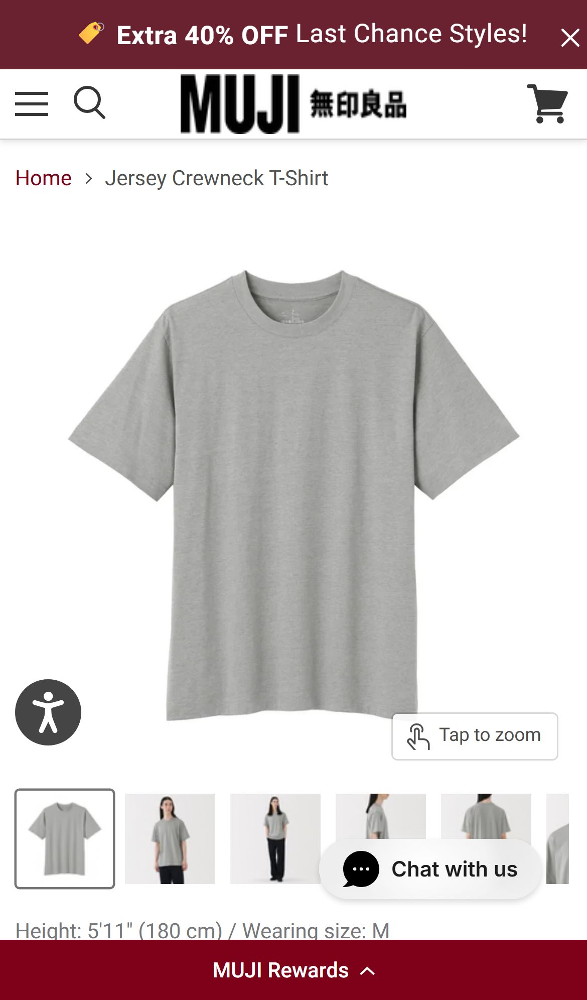 |

| Where | Observation | What it suggests for Standard Issue |
| --- | --- | --- |
| [Homepage](https://www.muji.us/) | Maroon bar "Extra 40% OFF Last Chance Styles!" above an "Early Black Friday, deals up to 30% off" hero. | Even the no-brand brand leads with discounts. A calm page with one fixed price stands apart. |
| [Homepage](https://www.muji.us/) | Cookie banner gives Accept and Decline equal-size buttons. | An honest consent pattern worth copying if Standard Issue ever adds analytics. |
| [Jersey Crewneck T-Shirt](https://www.muji.us/products/jersey-crew-neck-t-shirt-ab1mi25a) | $14.90; 108 reviews averaging about 4.5 stars, plus an "AI-generated" review summary. | Alex's price anchor is about $15. The $28 demo price needs a visible reason, or Alex compares and leaves. |
| [Jersey Crewneck T-Shirt](https://www.muji.us/products/jersey-crew-neck-t-shirt-ab1mi25a) | Colours on this listing: gray, navy, black (white sold out). Sizes M, L and XL crossed out. | Honest stock display. A white-only store can own "always in white" where Muji is patchy. |
| [Jersey Crewneck T-Shirt](https://www.muji.us/products/jersey-crew-neck-t-shirt-ab1mi25a) | Generic copy: "Comfort and style go hand in hand…". Model note "Height 5'11", wearing size M". | Fit help beats adjectives. Say less, but say something specific. |

- **Look:** modernist at the core (flat product shot on white, sans-serif, strict grid), but the shop theme adds chat bubbles, a rewards bar and sale colours. It reads as a generic retailer, not as Muji's famous emptiness.
- **Brand character:** Everyman with an Innocent streak. The archetype is in the name, not on the page.
- **Honest persuasion:** social proof (reviews, real but unverifiable by us); scarcity and urgency ("Last Chance", sold-out sizes: the sizes are factual, the deadline is seasonal); commitment (Muji Rewards).

## Everlane: transparency as the product

Direct competitor. Everlane sells the plain tee as a set of facts (certified cotton, factory, price history) rather than as a mood.

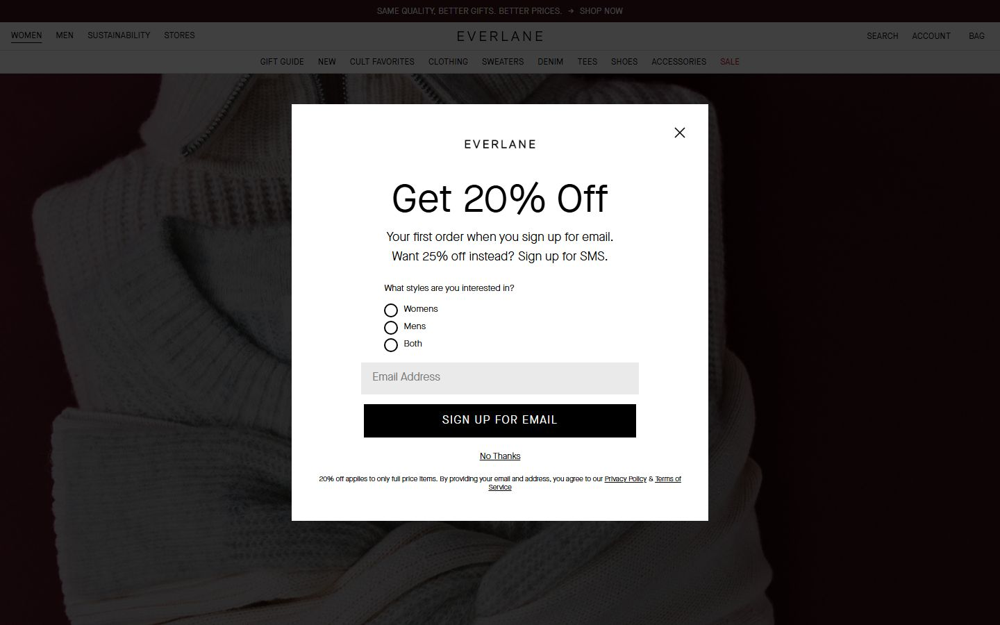

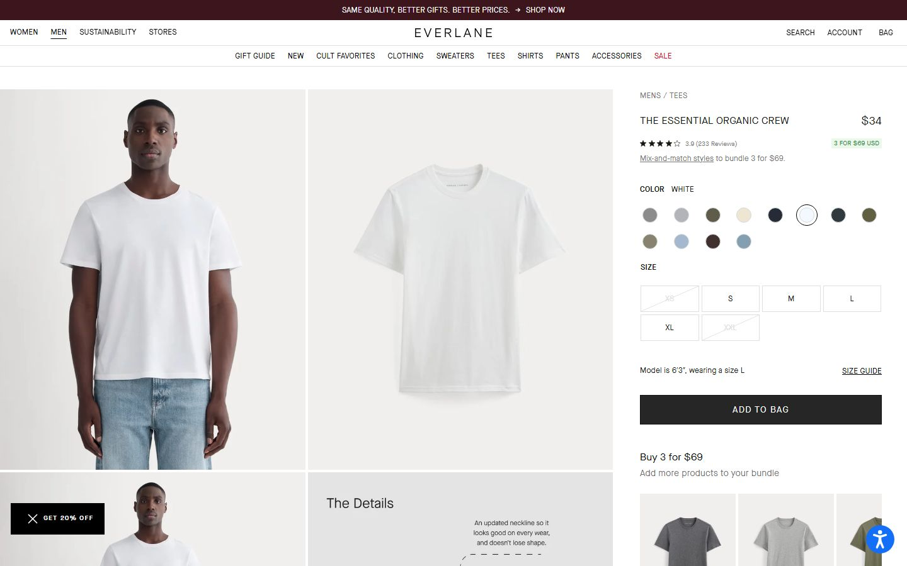

| Phone: homepage | Phone: product page |
| --- | --- |
| 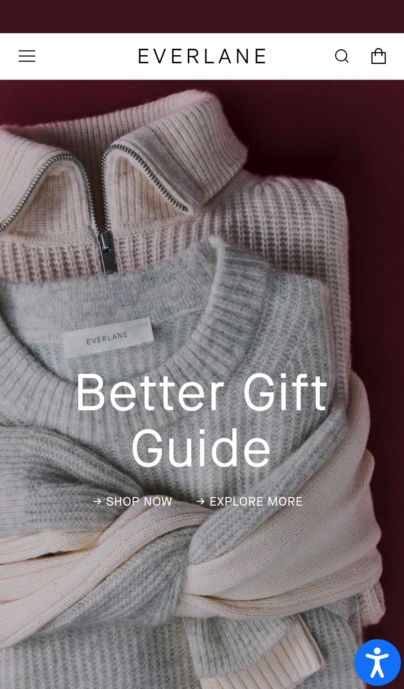 | 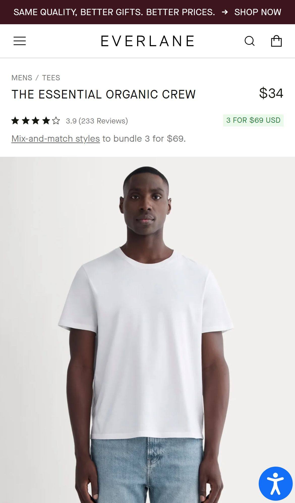 |

| Where | Observation | What it suggests for Standard Issue |
| --- | --- | --- |
| [Homepage](https://www.everlane.com/) | Popup: "Get 20% Off" for email, "25% off instead" for SMS, with a plain "No Thanks" link. | A discount traded for contact details. Easy to refuse, so it stays fairly honest. |
| [The Essential Organic Crew](https://www.everlane.com/products/mens-essential-organic-crew-uniform-white) | $34; 3.9 stars from 233 reviews shown openly. | A less-than-perfect score reads as real. |
| [The Essential Organic Crew](https://www.everlane.com/products/mens-essential-organic-crew-uniform-white) | "Mix-and-match styles to bundle 3 for $69" right under the price. | Basics shoppers restock in multiples. A multipack is a value lever, if the price is real. |
| [The Essential Organic Crew](https://www.everlane.com/products/mens-essential-organic-crew-uniform-white) | A "Price and feature comparison" table: "Past Everlane $38" vs "Still Everlane $34". | Anchoring against its own old price; we cannot verify it. |
| [The Essential Organic Crew](https://www.everlane.com/products/mens-essential-organic-crew-uniform-white) | "100% OCS-certified organic cotton" and a "Did You Know?" paragraph on water and pesticide use. | Material and ethics claims are Everlane's ground. Standard Issue has no such facts. |
| [The Essential Organic Crew](https://www.everlane.com/products/mens-essential-organic-crew-uniform-white) | "Model is 6'3", wearing a size L" next to the size grid; a red "Please Select Size" when adding without a size. | Concrete fit help is now expected, and so is clear missing-size feedback. |

- **Look:** strict modernism. Widely spaced uppercase wordmark, centred navigation, a two-column photo grid on pale grey, one black button.
- **Brand character:** Sage (it teaches you facts) on an Everyman base.
- **Honest persuasion:** authority (certification), social proof (reviews, "Cult Favorites"), commitment (bundle), reciprocity (discount for email), scarcity (sold-out sizes).

## Quince: luxury goods at value prices

Direct competitor, and the closest to Alex's "reliable while being cheap". Its top bar reads "High-quality essentials at radical prices."

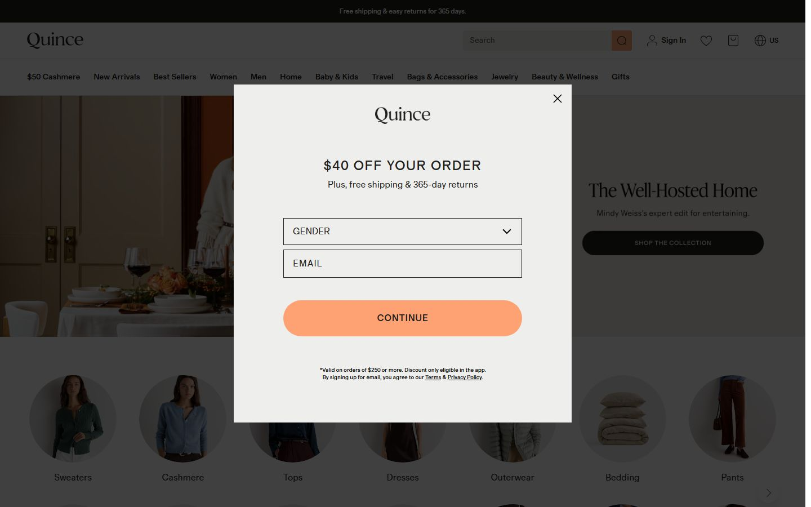

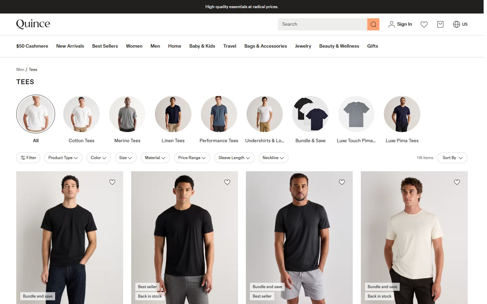

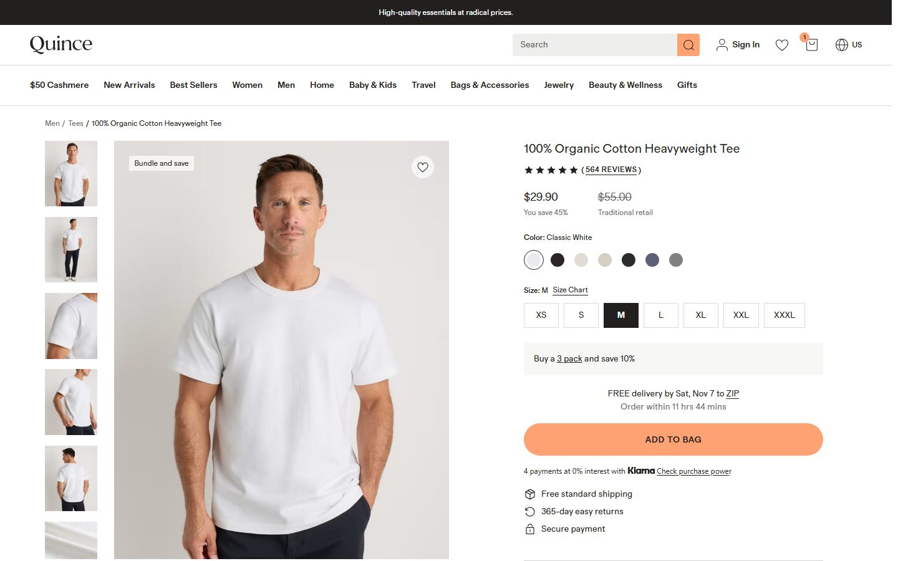

| Phone: homepage | Phone: product page |
| --- | --- |
| 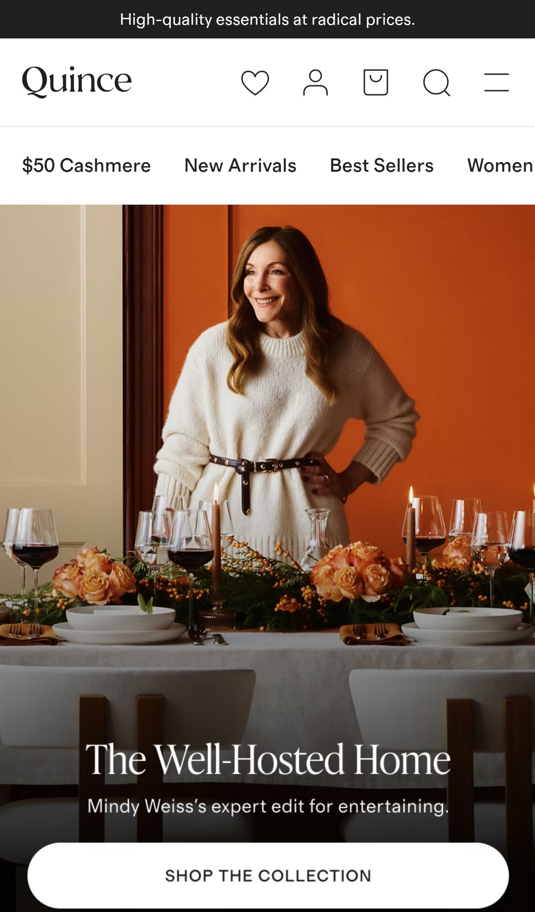 | 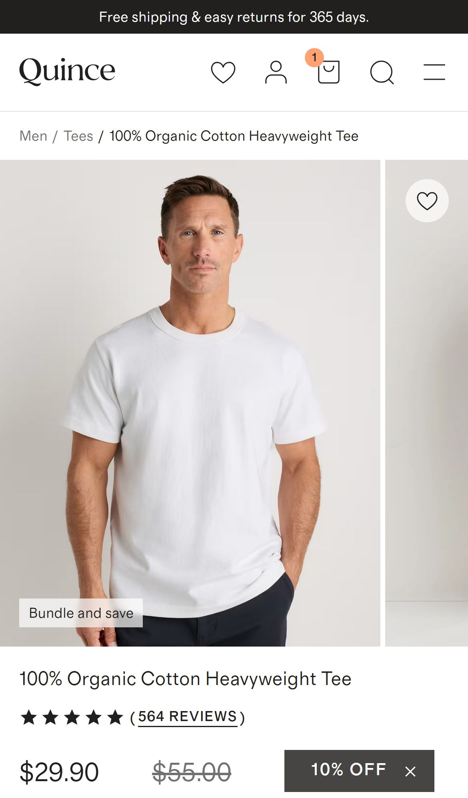 |

| Where | Observation | What it suggests for Standard Issue |
| --- | --- | --- |
| [Homepage](https://www.quince.com/) | Popup headline "$40 OFF YOUR ORDER"; the fine print says "Valid on orders of $250 or more. Discount only eligible in the app." | The big number hides two conditions. "No fine print" is a difference Standard Issue can own. |
| [Homepage](https://www.quince.com/) | Hero "The Well-Hosted Home", credited as "Mindy Weiss's expert edit". | Authority borrowed from a named expert. Standard Issue has none and should not imply one. |
| [Men's tees](https://www.quince.com/shop/men/tees) | 118 tees; badges "Best seller", "Back in stock", "Bundle and save". | Choice overload for a buyer who wants one plain tee. One shirt, one decision is Standard Issue's edge. |
| [Heavyweight Tee](https://www.quince.com/men/100-organic-cotton-heavyweight-relaxed-fit-jersey-tee?color=classic-white&size=m) | $29.90 beside a struck-through "$55.00" labelled "Traditional retail" and "You save 45%"; 564 reviews. | Anchoring on an unnamed "traditional retail" price nobody can check. Compare only against prices you can name. |
| [Heavyweight Tee](https://www.quince.com/men/100-organic-cotton-heavyweight-relaxed-fit-jersey-tee?color=classic-white&size=m) | "Buy a 3 pack and save 10%"; "Order within 11 hrs 53 mins" for a named delivery day; Klarna "4 payments at 0% interest". | A delivery cutoff helps planning. Pay-in-four on a $30 tee lowers spending friction more than it informs. |
| [Homepage](https://www.quince.com/) | Top bar: "Free shipping & easy returns for 365 days." | A strong risk reducer. A demo store can't promise this and should not imply it. |

- **Look:** modernist layout with a classic serif wordmark and serif headlines, one peach accent. Luxury cues on a discount grid.
- **Brand character:** Everyman (fair prices for everyone) borrowing Ruler signals ("$50 Cashmere", serif type).
- **Honest persuasion:** reciprocity with strings (the conditional $40), social proof ("Best seller"), scarcity ("Back in stock"), authority (the named expert edit), commitment (app-only discount).

## Sunspel: the premium reference, for Fiona

Adjacent reference, not a direct competitor: same product, a different buyer. It shows what the "refinement and a story" shopper is offered, at $98 a shirt.

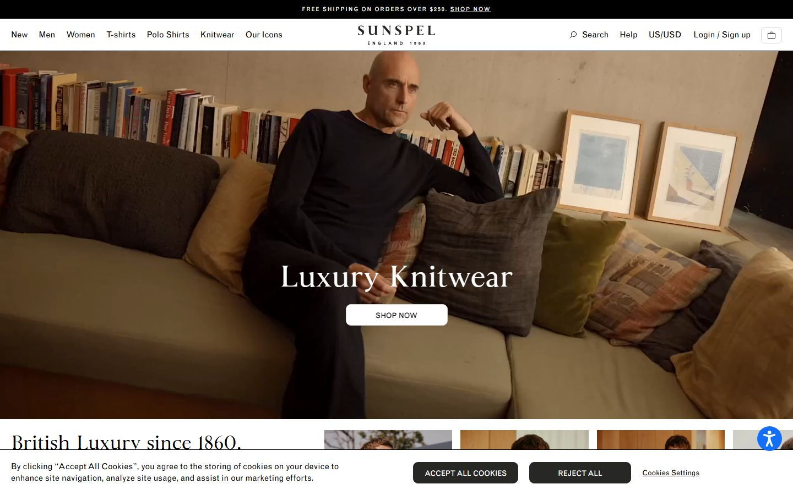

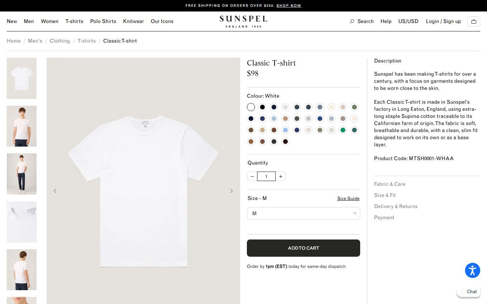

| Phone: homepage | Phone: product page |
| --- | --- |
| 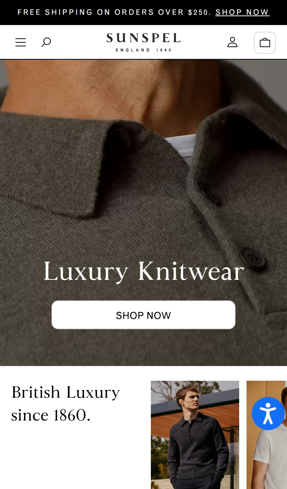 | 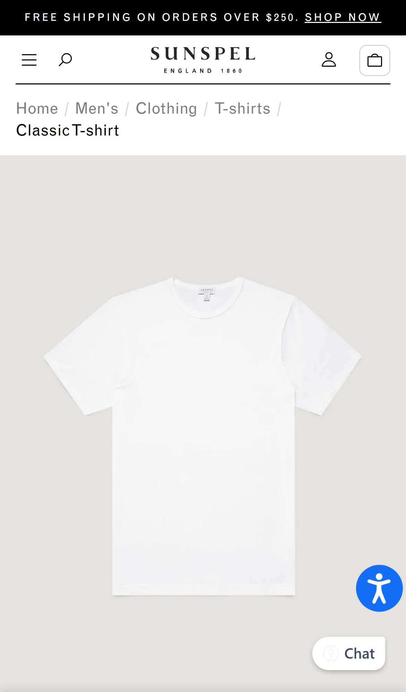 |

| Where | Observation | What it suggests for Standard Issue |
| --- | --- | --- |
| [Homepage](https://us.sunspel.com/) | "British Luxury since 1860." under the hero; the logo reads "SUNSPEL ENGLAND 1860". | Heritage is the whole argument. Standard Issue has none and should not fake age. |
| [Classic T-shirt](https://us.sunspel.com/products/mens-short-sleeve-crew-neck-t-shirt-white) | $98. "Made in Sunspel's factory in Long Eaton, England", Supima cotton "traceable to its Californian farm of origin". | Fiona pays for specific, checkable origin facts. "Good" without facts will not move her. |
| [Classic T-shirt, Bakelite colour](https://us.sunspel.com/products/mens-classic-tshirt-in-bakelite-mtsh0001-rdel) | Size menu showed "S (Only 2 left)", "XL (Only 2 left)", "XXL (Only 1 left)". | Scarcity tied to real stock counts: ethical because it is per size and specific. |
| [Classic T-shirt](https://us.sunspel.com/products/mens-short-sleeve-crew-neck-t-shirt-white) | "Order by 1pm (EST) today for same-day dispatch" under the button. | A deadline that helps the buyer plan, not a fake countdown. |
| [Homepage](https://us.sunspel.com/) | Free shipping only over $250; "Reject all" next to "Accept all cookies". | The premium tier does not compete on shipping perks. |

- **Look:** restrained, heritage modernism. Spaced serif caps logo, serif product names and prices, wide margins, quiet lifestyle photography.
- **Brand character:** Ruler (established, the standard others are measured by) with Creator craft (own factory).
- **Honest persuasion:** authority (since 1860, own factory, traceable cotton), scarcity (per-size stock counts), liking (aspirational lifestyle photos).

## Buying experience: product to checkout

All four allow guest checkout, and every one adds pressure or a default on the way. Walked with one white tee in size M; the walk stopped on the first checkout screen with nothing typed or submitted. Ticked or unticked states were read from the page code, not guessed from the image.

| Site | Between cart and checkout | Checkout: defaults and pressure | Honest touches | Express pay seen |
| --- | --- | --- | --- | --- |
| Muji | "Check out" opens an upsell modal: "Special Add-On! Get this sacoche bag for only $9.90!" ($14.90 struck through). | "Email me with news and offers" starts **ticked**. Four steps: Cart, Information, Shipping, Payment. Email "used for your order confirmation and cart reminders". | SMS opt-in starts unticked. "Coupons can be applied at checkout" stated up front. | Shop Pay, PayPal, Google Pay |
| Everlane | Bag drawer: "$41.00 away from free shipping", "Bundle 1 of 3 added", and **PackageProtect $1.75 already added**; the button reads "CHECKOUT \| $35.75" and removal needs "Continue Without PackageProtect". | The $1.75 fee carries into the order summary ("Subtotal · 2 items"). | Text opt-in and a "$0.16" carbon offset both start unticked. | Shop Pay, PayPal |
| Quince | Bag drawer: "These items are selling fast. Don't miss out!", plus "Recommended" and "Under $30 picks". | "Hurry! Your order is reserved for 10:00 minutes." Reopening the same checkout minutes later showed 09:26, so the clock appears to restart (not checked further). | Text opt-in starts unticked. Free shipping and 365-day returns beside the total. | Google Pay, PayPal |
| Sunspel | Basket offers "Add a Gift Box to your order ($10)", unticked. | "Sign up to get exclusive discounts, early sale access…" starts **ticked**. | "All US orders ship from our US warehouse – no customs, no duties." Help phone number in the header. | Shop Pay and more |
| Standard Issue | Bag, then checkout. No add-ons. | Shipping, Review, Done. No checkboxes, no timer. | Price and payment are labelled as a fictional demo. | None (demo) |

| Muji | Everlane |
| --- | --- |
| 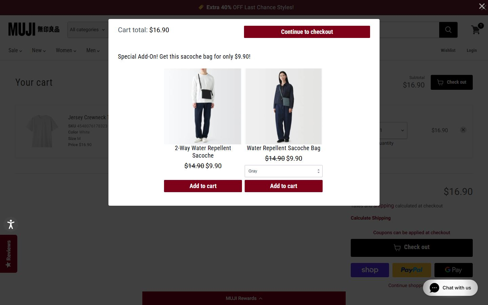 | 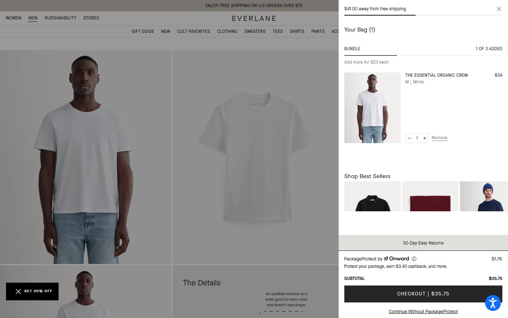 |
| 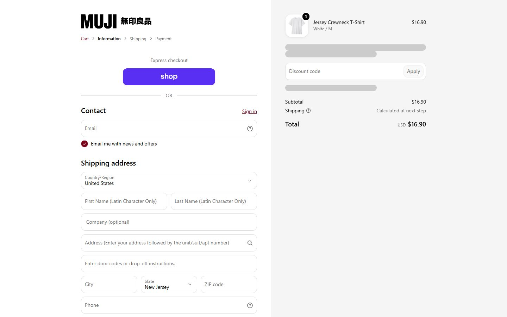 | 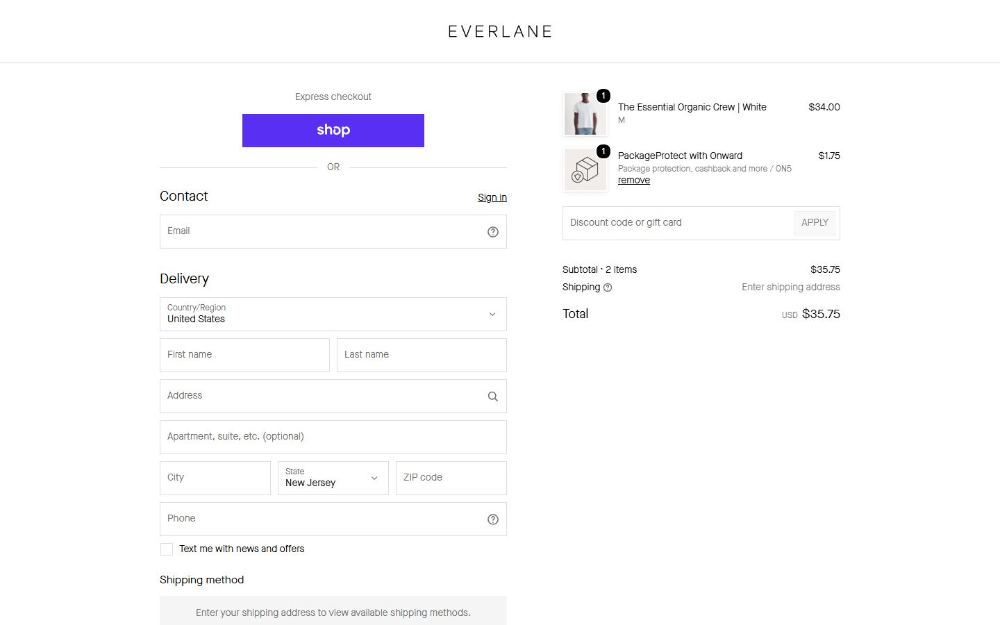 |

| Quince | Sunspel |
| --- | --- |
| 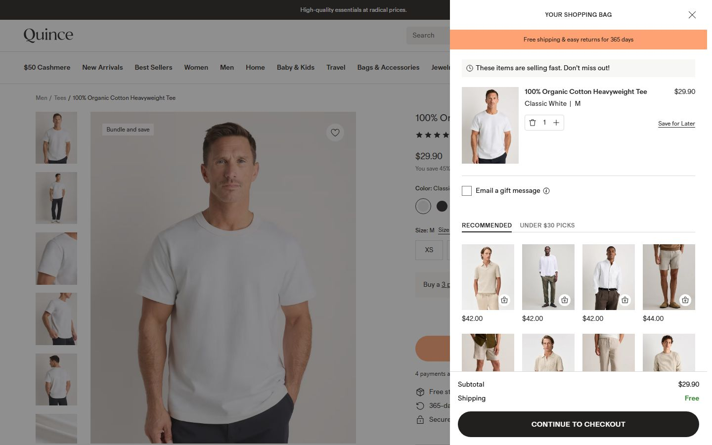 | 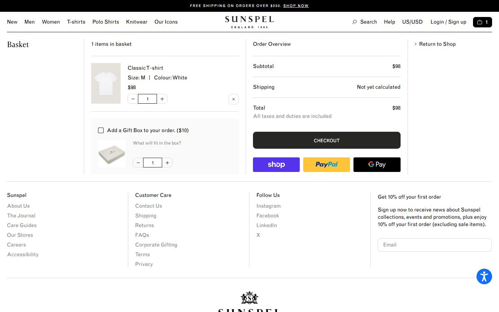 |
| 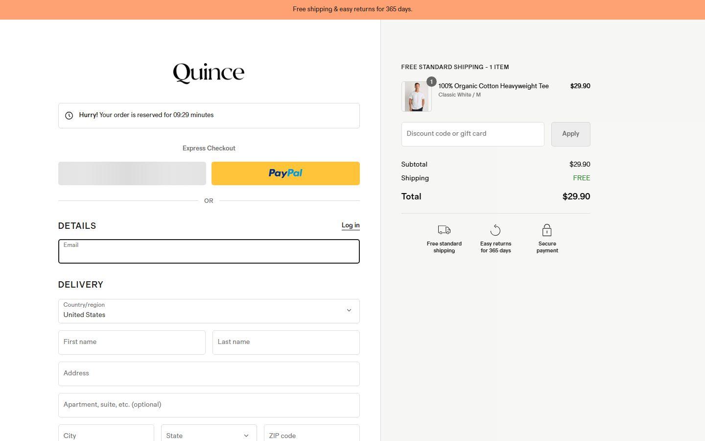 | 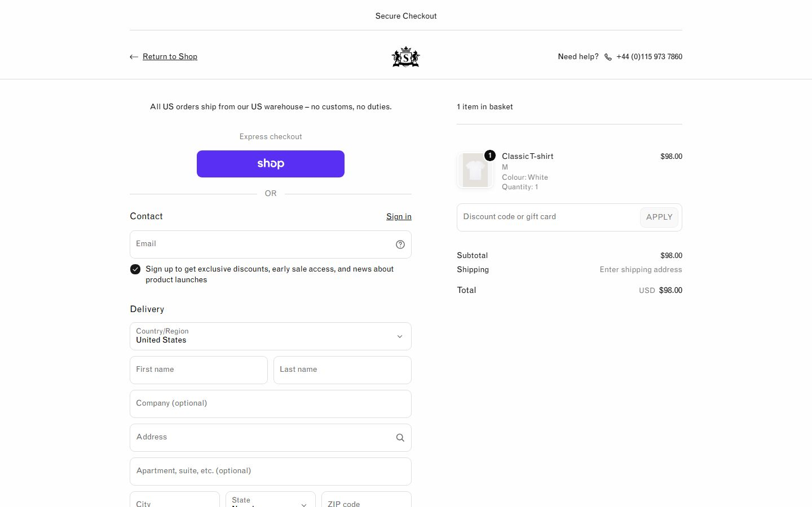 |

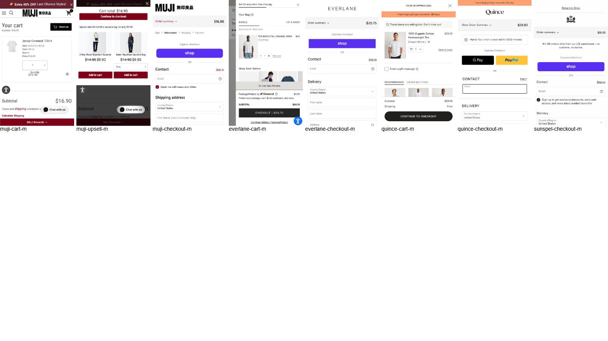

- **For Alex:** every competitor's checkout costs attention: a pitch, a fee to remove, a box to untick or a clock. Standard Issue's three-step, no-checkbox path is one Alex can finish without reading fine print.
- **Cialdini, honestly applied:** Sunspel's customs note and Everlane's free-shipping gap reduce real uncertainty. Pre-ticked boxes and a restarting timer use commitment and scarcity against the buyer.

## Two positions and two personas

The research favours position A for Alex: the value tier is loud with discounts and choice, and nobody there offers one calm, honest decision.

| | Position A: the honest default | Position B: the well-made basic with a story |
| --- | --- | --- |
| Who it serves | Alex, who wants a reliable white tee without a sales pitch | Fiona, who wants refinement and a story behind the product |
| Why they would choose it | One shirt, one price, no popups or fine print | Specific facts about origin and craft justify a higher price |
| Who already owns it | Nobody in this set: Muji, Quince and Everlane all lead with discounts, bundles or popups | Sunspel, with 1860 heritage, its own factory and traceable cotton, at $98 |
| Standard Issue's evidence | The voice and liking line already say "nothing more or less" | None: no material, factory or origin facts to show |
| Risk | At a $28 demo price, Alex sees Muji at $14.90 and Quince tees from $19.90 | Competing on story without facts would mean inventing claims |

| Persona hypothesis | Alex | Fiona |
| --- | --- | --- |
| Situation | Not chosen yet | Not chosen yet |
| Goal | "Reliable while being cheap"; "just a plain white T-shirt" (learner's words) | "Refinement, a story behind the product" (learner's words) |
| Uncertainty | Is $28 worth it next to $15 to $30 tees? | What makes this tee better than any other? |
| Evidence | Prices and checkout pressure observed 2026-11-03 | Sunspel's origin facts at $98 |
| Assumption | Not validated with real shoppers | Not validated with real shoppers |

**Primary audience:** Alex, the budget shopper (learner's choice, 2026-11-03). **Why** (learner's words, 2026-11-04): "it was the closest to what I would be as a buyer for a white t-shirt like this. So I could see and evaluate it personally, other than projecting it to a character archetype."

| Still open | Status |
| --- | --- |
| Class feedback (Nov 5) | Issue not yet created |
| Open question | Does the $28 demo price need a reason Alex can check, or a lower price? |

## What Standard Issue can take from this

AI suggestions drawn from the observations above, not decisions.

1. **Keep the first visit calm.** Three of four competitors open with a discount or sale banner. No popup and no fine print is the visible proof of "nothing more or less".
2. **Answer the price question on the page.** Either move the demo price into the $15 to $30 range, or give a reason made only of facts that can be supported.
3. **Put fit help beside the size picker.** Muji and Everlane show the model's height and size worn. A plain size chart would do, but only with real measurements.
4. **Keep the postmodern label look, and test it.** It is the only non-modernist design in this set; the risk is that kraft and stamps read as cheap or as a costume.
5. **Don't compete on materials or heritage.** Everlane owns certified cotton and Sunspel owns 1860; inventing equivalents would break the brand's product boundary.

## Mobbin

Not checked: Mobbin needs a signed-in account, and a logged-out search redirected to its sign-up page on 2026-11-03. The live walk-throughs above cover these four checkouts first-hand.

## Method, AI use and limits

- **How:** Claude (an AI assistant) drove headless Chromium through Playwright 1.64: desktop at 1440 × 900, phone as iPhone 13. Cookie banners were declined and sign-up popups closed before the clean captures. Checkout walks stopped on the first checkout screen; nothing was typed or submitted.
- **What the AI did:** captured the pages, wrote the observations and the archetype, Cialdini and modernism readings. The persona goals are the learner's own words from the [Brand Studio record](https://github.com/mnguyenht/is117-brand-assignment/blob/main/SPEC.md); the audience choice is the learner's to make.
- **Limits:** one day's snapshot during early Black Friday season; prices and banners will change. Brand readings are interpretations. Personas are untested hypotheses. Uniqlo and Hanes were blocked (403). Quince's delivery ZIP code, inferred from the network, was redacted. Screenshots of third-party sites are included for commentary and study.

## Sources

All opened on 2026-11-03.

- [Muji US homepage](https://www.muji.us/), [Jersey Crewneck T-Shirt](https://www.muji.us/products/jersey-crew-neck-t-shirt-ab1mi25a), [Jersey Crewneck T-Shirt, white (checkout walk)](https://www.muji.us/products/jersey-crewneck-t-shirt-ab1mi26s)
- [Everlane homepage](https://www.everlane.com/), [The Essential Organic Crew, white](https://www.everlane.com/products/mens-essential-organic-crew-uniform-white)
- [Quince homepage](https://www.quince.com/), [Men's tees](https://www.quince.com/shop/men/tees), [100% Organic Cotton Heavyweight Tee](https://www.quince.com/men/100-organic-cotton-heavyweight-relaxed-fit-jersey-tee?color=classic-white&size=m)
- [Sunspel US homepage](https://us.sunspel.com/), [Classic T-shirt in white](https://us.sunspel.com/products/mens-short-sleeve-crew-neck-t-shirt-white), [Classic T-shirt in Bakelite](https://us.sunspel.com/products/mens-classic-tshirt-in-bakelite-mtsh0001-rdel)
- [Uniqlo US](https://www.uniqlo.com/us/en/) and [Hanes](https://www.hanes.com/): 403 Access Denied, not captured
- [Mobbin](https://mobbin.com/): logged-out search redirects to sign-up
- Standard Issue: [live store](https://standard-issue-is117.vercel.app), [SPEC.md](https://github.com/mnguyenht/is117-brand-assignment/blob/main/SPEC.md)
